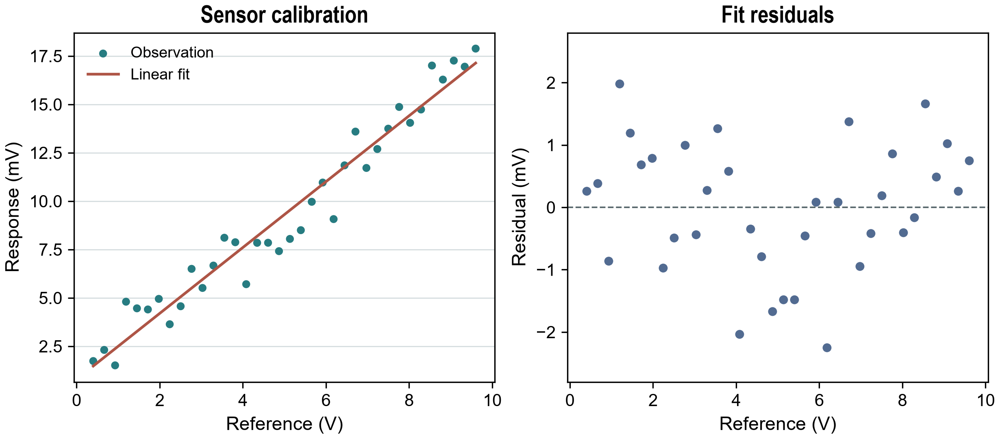
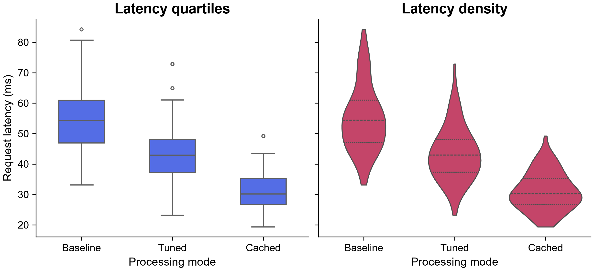
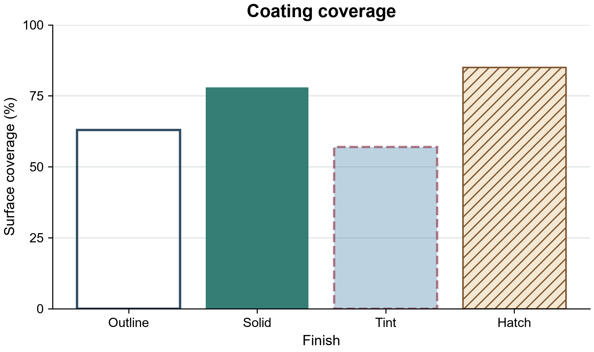
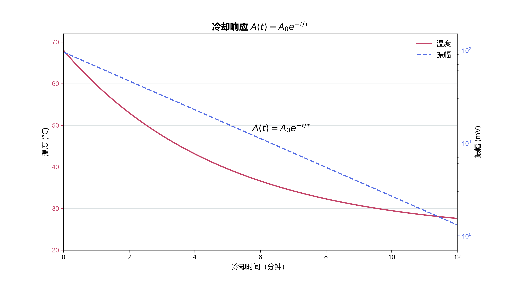
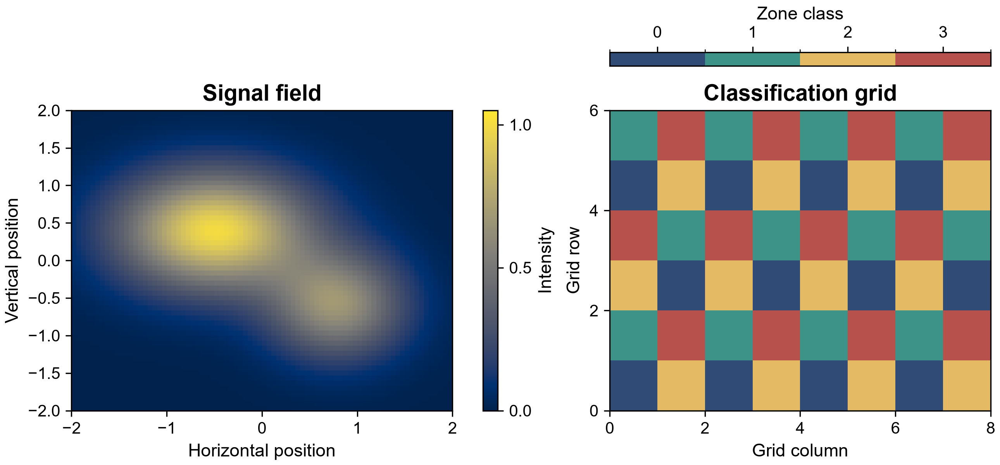

# mpl2pptx

把 Matplotlib 或 Seaborn 导出的 SVG 转成可编辑的 PowerPoint 幻灯片。幻灯片采用 SVG 的物理画幅，并具有可编辑的文本、公式、曲线、填充和边框。

本项目在 Python 3.12、Matplotlib 3.11.2 和 PowerPoint 2024 上完成了端到端测试。

## 支持的特性

| 项目 | 在 PowerPoint 中的效果 |
| --- | --- |
| 普通文字 | 标题、刻度和图例等可转为文本框，保留字体、字号、字重、水平/垂直对齐方式（SVG 缺少对齐信息时按位置推断）。 |
| 矢量图形 | 散点可逐个选中，曲线可调整顶点。网格、柱形、箱体和小提琴轮廓均可作为形状编辑。 |
| 填充与边框 | 沿用 SVG 中的颜色和透明度；对于虚线，可保留段长和间隔。 |
| 栅格图层 | `imshow` 和已栅格化的散点、色条（`rasterized=False`）保留为图片。[Matplotlib 栅格化说明](https://matplotlib.org/stable/gallery/misc/rasterization_demo.html) |
| 数学公式 | `$...$` 数学公式可转换为可编辑的 PPTX 公式，支持独立公式和行内公式。本功能依赖于 Matplotlib 导出为 SVG 时的公式源码注释。[Office 行内公式说明](https://learn.microsoft.com/en-us/openspecs/office_standards/ms-odrawxml/cdafda97-9124-48ed-8d64-7f1dd9197c8a) |
| 图案填充 | 横线、竖线、斜线和交叉线等 hatch 转换为 Office 预设的图案填充；圆点、星形等其他图案的 hatch 可能丢失。[Matplotlib 填充图案说明](https://matplotlib.org/stable/gallery/shapes_and_collections/hatch_style_reference.html) |
| 页面尺寸 | 沿用 SVG 的物理宽高，每边支持 2.54 至 142.24 cm。[Office 页面尺寸说明](https://support.microsoft.com/en-us/powerpoint/change-the-size-of-your-powerpoint-slides) |

> 如果在您的 SVG 上表现异常，可以提交 GitHub Issue

## 示例

**校准曲线与残差** | [绘图脚本](tests/demo/test_calibration.py) · [保存的 SVG](assets/examples/calibration.svg) · [可编辑 PPTX](assets/examples/calibration.pptx)



**箱线图与小提琴图** | [绘图脚本](tests/demo/test_distributions.py) · [保存的 SVG](assets/examples/distributions.svg) · [可编辑 PPTX](assets/examples/distributions.pptx)



**柱形的填充与边框** | [绘图脚本](tests/demo/test_bar_styles.py) · [保存的 SVG](assets/examples/bar_styles.svg) · [可编辑 PPTX](assets/examples/bar_styles.pptx)



**线性与对数双 Y 轴** | [绘图脚本](tests/demo/test_dual_axis.py) · [保存的 SVG](assets/examples/dual_axis.svg) · [可编辑 PPTX](assets/examples/dual_axis.pptx)



**连续与离散色条** | [绘图脚本](tests/demo/test_colorbars.py) · [保存的 SVG](assets/examples/colorbars.svg) · [可编辑 PPTX](assets/examples/colorbars.pptx)




## 安装

通过下述指令安装以使用：

```powershell
python -m pip install .
```

也可使用下述指令以开发、运行示例和测试：

```powershell
python -m pip install -e ".[examples,test]"
```

其中，部分示例依赖于 Microsoft YaHei 和 Arial Narrow 字体。


## 使用

> 技术参考：[Matplotlib Figure.savefig](https://matplotlib.org/stable/api/_as_gen/matplotlib.figure.Figure.savefig.html) · [PowerPoint Shapes.AddPicture](https://learn.microsoft.com/en-us/office/vba/api/powerpoint.shapes.addpicture)

> 如果您手头没有可用的 SVG 文件，可使用仓库中的样例文件 `assets/examples/dual_axis.svg`。


### 从 SVG 文件转换

对于 matplotlib 创建的 svg 文件，通过 `svg2pptx` 将它转换为可编辑的 PPTX 文件。

```python
import matplotlib.pyplot as plt
fig = plt.figure()
# ... (在 fig 中绘制图像)
fig.savefig('test.svg')

from mpl2pptx import svg2pptx
# save 默认为 {svg-name}.pptx;
# version 默认为 2024 (暂只支持 PowerPoint 2024)
pptx_path = svg2pptx("test.svg", save="test.pptx", version="2024")
```
`svg2pptx` 的首个参数除了文件路径 `test.svg`，也支持 SVG 字节或二进制输入流。当使用二进制输入流且未指定 save 时，返回 PPTX 字节流。

`svg2pptx` 允许通过指定 `return_details=True` 以获取转换详情：

```python
report = svg2pptx("test.svg", save="test.pptx", version="2024", return_details=True)

print(report["output"]) # 正常返回的路径、PPTX 字节或输出流
print(report["version"]) # 目标 PowerPoint 版本
print(report["detected"]) # 已识别的特殊元素总数
print(report["converted"]) # 成功写成原生元素的数量
print(report["unconverted"]) # detected 与 converted 两者之差
print(report["elements"])  # `text`、`equations`、`hatches`、`dashes` 等特殊元素的的 `detected` 与 `converted` 数量

# 含普通文字的一行计入 text 一次，每段 $...$ 分别计入 equations。
# 若行内某个公式无法转换，会提示并保留整行原图形，该行各项计入 unconverted。
# 同一根柱的 hatch 和虚线边框各计一项。栅格图层的输出数量单列于 pictures。

print(report["pictures"]) # 已处理的图片对象数
print(report["shapes"]) # 已处理的 PowerPoint 原生形状数（含文本框和公式）
print(report["figures"]) # 已处理的 SVG 图数

```


> 注：matplotlib 中保存图片为 SVG 时默认使用轮廓模式，此时 svg2pptx 通过注释信息恢复原始文字和数学公式（参见 [Matplotlib 字体导出说明](https://matplotlib.org/stable/users/explain/text/fonts.html)）。也可通过指定 `svg.fonttype="none"` 使得 svg 中文字直接以可读取的字符形式保存。


### 直接保存 Figure

直接将 matplotlib 创建的 figure 保存为 PPTX 文件（代码会在私有临时目录中写入处理过的 SVG 和暂存文稿，完成后清理）。同样允许指定 `return_details=True` 以获取转换详情。

```python
import matplotlib.pyplot as plt
fig = plt.figure()
# ... (在 fig 中绘制图像)
fig.savefig('test.svg')

from mpl2pptx import save_pptx
# version 默认为 2024 (暂只支持 PowerPoint 2024)
path = save_pptx(fig, "test.pptx", version="2024")
```

### 从命令行转换

在 shell 中通过 `mpl2pptx` 指令，直接将 SVG 转换为可编辑的 PPTX 文件。完成转换后，指令会打印输出路径、逐类识别与实际转换数量，以及生成的原生形状和图片对象数等详细信息。
```powershell
# `--output` (或 `-o`) 指定输出路径，默认为 {svg-name}.pptx
# `--powerpoint-version` 默认为 2024 (暂只支持 PowerPoint 2024)
mpl2pptx test.svg --output test.pptx --powerpoint-version 2024
```

转换时必须显式指定输入路径。使用 `mpl2pptx --help` 查看完整选项。


## 运行测试

```powershell
python -m pytest -q
```

其中：
- `tests/test_*.py` 为单元测试。可用 `-m "not office"` 指定只运行单元测试（或用 `-m office` 指定只运行集成测试）。
- `tests/integration/` 使用桌面 PowerPoint 验证公开接口。在缺少 Windows 桌面 PowerPoint 的环境下会默认跳过。
- `tests/demo/` 给出五份集成测试；也允许作为普通 Python 脚本运行。指定 `--output-dir` 时，每个 `tests/demo/test_*.py` 会向指定目录写出一对 SVG 和 PPTX 文件。

```powershell
python -m pytest -q --output-dir assets/examples
python tests/demo/test_bar_styles.py --output-dir my-plots
```


## 项目目录

```text
src/mpl2pptx/
    api.py                      svg2pptx、save_pptx 和转换流程
    cli.py                      命令行参数、输入校验与结果显示
    report.py                   识别数量和实际转换数量
    namespaces.py               SVG、DrawingML、Office Math 的 XML 名称
    svg/
        document.py             读取 SVG、计算物理尺寸、解析坐标变换和样式
        text.py                 恢复文字、字体、对齐方式，识别数学标签
        prepare.py              标记待恢复的文字、图案填充和虚线
    pptx/
        powerpoint.py           调用桌面 PowerPoint 并恢复可编辑对象
        stage_svg.ps1           通过 PowerPoint COM 插入 SVG、转形状和取消组合
        writer.py               写入原生形状、文本框、公式和 PPTX 文件
        equations.py            将数学表达式转为 Office Math
tests/                          Python API、CLI、SVG 和 PPTX 的单元测试
    integration/                用桌面 PowerPoint 检查公开接口的端到端测试
    demo/                       五份可独立运行的绘图示例与集成测试
assets/examples/                示例 SVG、PPTX 和渲染预览
```
